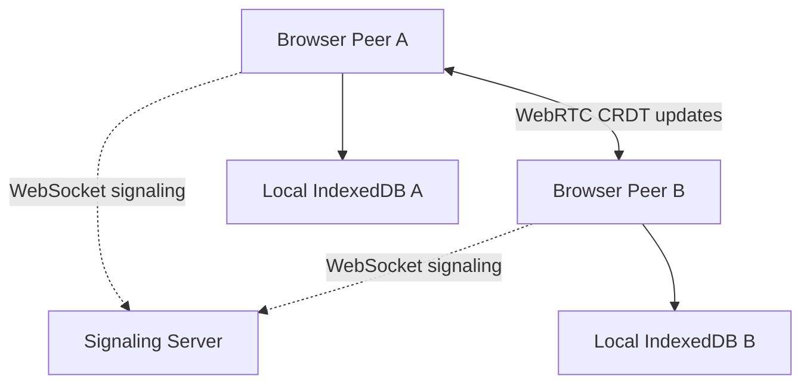
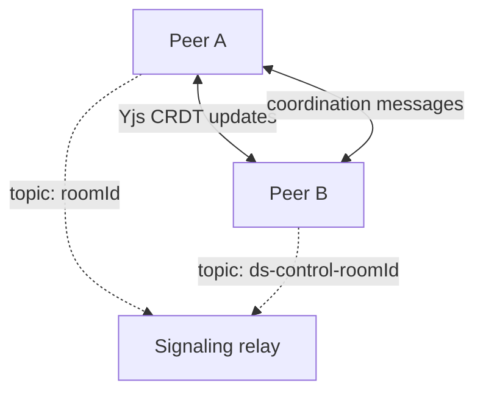

# Collaborative Real-Time Markdown Editor

A lightweight, distributed Markdown editor that allows multiple users to edit the same document simultaneously.

The application uses WebRTC for peer-to-peer communication and Yjs CRDTs for automatic conflict resolution. Document content is not stored in a central database.

## Features

* Create and join collaboration rooms
* Share rooms through unique URLs
* Real-time peer-to-peer Markdown editing
* Automatic conflict resolution using Yjs CRDT
* Live rendered Markdown preview
* Remote user cursors and selections
* Connected collaborator list
* Local document persistence using IndexedDB
* Offline recovery after refreshing or reopening a room
* SHA-256 document hash for verifying replica convergence
* Download the document as a `.md` file
* Responsive user interface

## Distributed Architecture



Each browser maintains its own replica of the shared document.

The signaling server helps peers discover each other and establish WebRTC connections. It does not store or process the Markdown document.

After the connection is established, Yjs document updates are transmitted directly between peers.

## How Conflict Resolution Works

The editor uses a Conflict-Free Replicated Data Type, or CRDT, provided by Yjs.

When users edit simultaneously:

1. Each edit is applied immediately to the user’s local replica.
2. Yjs converts the edit into a mergeable CRDT update.
3. The update is sent to connected peers through WebRTC.
4. Remote peers merge the update into their replicas.
5. Once every update has been received, all replicas converge to the same document.

This allows concurrent editing without locking the document or selecting one central replica as the authoritative copy.

## Technologies

| Technology          | Purpose                                 |
| ------------------- | --------------------------------------- |
| React               | User interface                          |
| TypeScript          | Type-safe application code              |
| Vite                | Development and production build system |
| CodeMirror 6        | Markdown text editor                    |
| React Markdown      | Rendered Markdown preview               |
| Yjs                 | CRDT document and conflict resolution   |
| y-webrtc            | Peer-to-peer Yjs synchronization        |
| WebRTC DataChannels | Direct browser-to-browser communication |
| WebSocket           | Signaling and peer discovery            |
| Yjs Awareness       | User presence and remote cursors        |
| IndexedDB           | Local document persistence              |
| React Router        | Room-based URLs                         |

## Distributed Systems Concepts

| Concept                        | Implementation                                             |
| ------------------------------ | ---------------------------------------------------------- |
| Distributed system             | Multiple browsers maintain document replicas               |
| Hybrid architecture            | Client-server discovery followed by P2P communication      |
| Middleware                     | Yjs handles CRDT operations and synchronization            |
| Peer-to-peer messaging         | WebRTC DataChannels exchange document updates              |
| Message-oriented communication | WebSocket messages perform signaling                       |
| Naming and identifiers         | UUID room IDs and Yjs client IDs                           |
| Eventual consistency           | Replicas converge after receiving the same updates         |
| Conflict resolution            | Concurrent edits are merged using a CRDT                   |
| Replication                    | Each peer stores a copy of the shared document             |
| Fault tolerance                | Local persistence and reconnection support                 |
| Transparency                   | Users edit normally without managing synchronization       |
| Partial failure                | Existing peers can continue after another peer disconnects |

## Project Structure

```text
collaborative-markdown-editor/
├── src/
│   ├── components/
│   │   └── MarkdownEditor.tsx
│   ├── pages/
│   │   ├── HomePage.tsx
│   │   └── EditorPage.tsx
│   ├── App.tsx
│   ├── App.css
│   ├── index.css
│   └── main.tsx
├── public/
├── package.json
├── vercel.json
└── README.md
```

## Prerequisites

Install the following:

* Node.js, preferably the current LTS release
* npm
* Git
* Chrome and Firefox for cross-browser testing

## Local Setup

Clone the repository:

```bash
git clone https://github.com/iamRUDRAKSH/collaborative-markdown-editor.git
cd collaborative-markdown-editor
```

Install dependencies:

```bash
npm install
```

Start the React development server:

```bash
npm run dev
```

Open another terminal and start the signaling server:

```bash
PORT=4444 npm run signaling
```

Open the URL displayed by Vite, normally:

```text
http://localhost:5173/
```

## Production Build

Create a production build:

```bash
npm run build
```

Preview the production build:

```bash
npm run preview
```

Keep the signaling server running separately:

```bash
PORT=4444 npm run signaling
```

The preview normally opens at:

```text
http://localhost:4173/
```

## Testing Collaboration

1. Open the application in Chrome.
2. Enter a username and create a room.
3. Copy the room link.
4. Open the link in Firefox.
5. Enter a different username.
6. Edit the document from both browsers.
7. Confirm that updates appear in both browsers.
8. Edit the same line simultaneously.
9. Confirm that both document hashes eventually match.

Using different browsers is important because tabs in the same browser may communicate through `BroadcastChannel` instead of WebRTC.

## Fault-Tolerance Tests

### Local persistence

1. Enter text into a room.
2. Refresh the browser.
3. Confirm that the text is restored from IndexedDB.

### Peer disconnection

1. Connect Chrome and Firefox to the same room.
2. Close one browser.
3. Confirm that the remaining peer can continue editing.

### Signaling failure

1. Establish a connection between two peers.
2. Stop the signaling server.
3. Confirm that existing WebRTC peers can continue communicating.
4. Confirm that a new peer cannot join until signaling is restored.

### Room isolation

1. Create two different rooms.
2. Add different content to each room.
3. Confirm that updates never cross between rooms.

## Deployment

The application uses two deployment targets:

* Vercel for the React frontend
* A WebSocket-compatible service such as Render for the signaling server

The production frontend requires:

```text
VITE_SIGNALING_URL=wss://your-signaling-service.example.com
```

Local development falls back to:

```text
ws://localhost:4444
```

Production uses `wss://` because the deployed frontend is served over HTTPS.

## Limitations

* The WebRTC mesh architecture is intended for small collaboration groups.
* A signaling server is required when new peers join.
* Documents are stored locally in each browser rather than in a central database.
* Clearing browser storage removes that browser’s local document copy.
* If all replicas are lost, the document cannot be recovered centrally.
* Restrictive networks may require a TURN server for WebRTC connectivity.
* Room URLs currently act as access identifiers and do not provide complete authentication or authorization.

## Future Enhancements

Possible FA-2 extensions include:

* Authentication and room permissions
* Encrypted or password-protected rooms
* Document history and versioning
* Distributed snapshots and backup replicas
* Improved network-partition simulation
* Communication failure metrics
* TURN server support
* Rich-text collaborative editing
* Comments and annotations
* Distributed leader election or coordination mechanisms

## FA-2: Distributed Coordination (Units 3 and 4)

FA-1 built a system that *deliberately avoids coordination*. A CRDT converges without
agreement, which is why consensus, mutual exclusion and election had nothing to attach to.

FA-2 adds the features that make coordination unavoidable, then implements the classical
algorithms that provide it. The driving feature is **exclusive section locks**: a user may
claim a document section for restructuring, during which nobody else may edit it. A CRDT
fundamentally cannot express that guarantee, and everything below follows from needing it.

All of it lives in `src/ds/` and is visible at runtime through the **Distributed Systems
Inspector** below the editor.

### Unit 3: Synchronization

| Concept | Implementation | File |
| ------- | -------------- | ---- |
| Logical Clocks, Lamport's Algorithm | Lamport counter stamped on every message; total order with node-id tiebreak | `ds/clocks.ts` |
| Vector Algorithm | Vector clocks with exact happened-before / concurrent detection | `ds/clocks.ts` |
| Clock Synchronization | Cristian's algorithm from beacon round trips; Berkeley averaging run by the coordinator | `ds/clocksync.ts` |
| beacon protocol | Periodic beacons carrying clocks and lock state; doubles as the failure detector | `ds/beacon.ts` |
| Election Algorithms | Bully and Chang-Roberts ring, switchable at runtime, with measured message counts | `ds/election.ts` |
| Mutual Exclusion Algorithms | Centralized, Lamport, Ricart-Agrawala, token ring, and a fair variant | `ds/mutex.ts` |
| Global State | Chandy-Lamport snapshot with markers and recorded channel state | `ds/snapshot.ts` |
| Knapp's classification (self study) | Edge-chasing deadlock detection (Chandy-Misra-Haas) | `ds/deadlock.ts` |

### Unit 4: Emerging Distributed Paradigms

| Concept | Implementation | File |
| ------- | -------------- | ---- |
| Distributed Object-Based Systems | RPC with stubs, request ids, deadlines and at-most-once semantics | `ds/rpc.ts` |
| Distributed file system | Content-addressed 64 KB chunks, replication factor 2, re-replication on peer loss | `ds/store.ts` |
| Serverless Architectures | Cloudflare Worker + Durable Object signaling | `deploy/cloudflare/` |
| Kubernetes (case study) | Dockerfile and manifests for the signaling tier | `deploy/docker/`, `deploy/k8s/` |
| Blockchain / DLT (self study) | Snapshots hash-chained to their predecessor | `ds/snapshot.ts` |
| Apache Hadoop (case study) | The chunk store is HDFS in miniature; the comparison is documented in `ds/store.ts` |  |

### Gaps closed from FA-1

| FA-1 gap | FA-2 answer |
| -------- | ----------- |
| No RPC anywhere | `ds/rpc.ts`, used by every service |
| Library owned every `RTCPeerConnection` | We drive our own offer/answer, ICE and data channel in `ds/transport.ts` |
| No distributed multimedia | Camera and microphone over the same peer connections, with renegotiation |
| Stream-oriented communication had no QoS | Latency, jitter, loss and bitrate from `getStats()` in `ds/qos.ts` |
| No TURN relay | `VITE_TURN_*` adds a relay candidate |
| No security | Optional room key encrypts the Yjs room: `/room/<id>#key=<secret>` |
| No virtualization | Dockerfile and Kubernetes manifests |
| Username shared across tabs | Per-tab identity in `sessionStorage` |

### Architecture

Two independent meshes share one signaling relay on different topics:



The Yjs replica is untouched by FA-2: it still converges without coordination. The second
mesh carries clocks, beacons, elections, lock requests, markers and RPC. Keeping them
separate means a failure in the coordination layer degrades guarantees without ever
threatening document convergence.

### Demonstrating each algorithm

Open the room in **two different browsers**, with a different name in each.

1. **Clocks** - *Nodes & Clocks*. Lamport counters advance on every message; vector clocks
   show per-node components; the measured clock offset is rarely zero, which is the reason
   the ordering algorithms never use wall-clock time.
2. **Election** - switch between Bully and Ring, press *Force election*, and compare the
   message counts. Then close the coordinator's browser: the survivor detects the missing
   beacons and elects itself.
3. **Mutual exclusion** - lock a section in one browser and try to type into it in the
   other; the edit is rejected. Switch algorithms and compare measured messages against the
   stated bound (3 vs 3(n-1) vs 2(n-1)).
4. **Global state** - press *Take snapshot* while both peers are typing. The snapshot
   records each node's state plus the messages in flight, and chains to the previous hash.
5. **Deadlock** - lock section A here and section B there, then each request the other's.
   Within a few seconds a probe returns to its initiator and the cycle is reported and
   broken.
6. **File store** - upload a file, then close the other browser and download it again: the
   chunks were replicated, so it still reassembles and passes its integrity check.
7. **Media and QoS** - start the camera and watch jitter and loss appear, which the
   reliable data channel never reports.

### Limitations worth stating

* Lock enforcement is cooperative. The filter rejects local edits into a locked section,
  but nothing in a peer-to-peer CRDT can stop a modified client from writing anyway.
* The failure detector is unreliable in the formal sense: a slow network is
  indistinguishable from a crashed peer, so a live coordinator can be wrongly replaced.
* Token-ring mutual exclusion loses its token when the holder crashes; the lowest live id
  regenerates it after a timeout, which can briefly admit two holders.
* Replicas live in browser tabs, so the file store's durability is bounded by how many
  tabs stay open.
* The mesh is still O(n^2) and still unsuitable for large groups.

## Author

Created by [iamRUDRAKSH](https://github.com/iamRUDRAKSH) as a Distributed Systems mini project (FA-1 and FA-2).