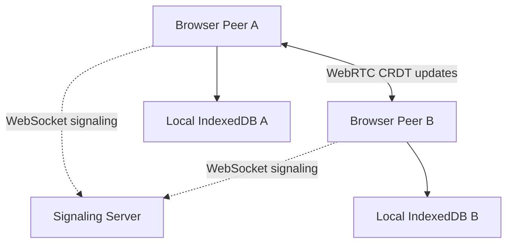

# Collaborative Real-Time Markdown Editor

A lightweight, distributed Markdown editor that allows multiple users to edit the same document simultaneously.

The application uses WebRTC for peer-to-peer communication and Yjs CRDTs for automatic conflict resolution. Document content is not stored in a central database.

## Features

* Create and join collaboration rooms
* Share rooms through unique URLs
* Real-time peer-to-peer Markdown editing
* Automatic conflict resolution using Yjs CRDT
* Live rendered Markdown preview
* Remote user cursors and selections
* Connected collaborator list
* Local document persistence using IndexedDB
* Offline recovery after refreshing or reopening a room
* SHA-256 document hash for verifying replica convergence
* Download the document as a `.md` file
* Responsive user interface

## Distributed Architecture



Each browser maintains its own replica of the shared document.

The signaling server helps peers discover each other and establish WebRTC connections. It does not store or process the Markdown document.

After the connection is established, Yjs document updates are transmitted directly between peers.

## How Conflict Resolution Works

The editor uses a Conflict-Free Replicated Data Type, or CRDT, provided by Yjs.

When users edit simultaneously:

1. Each edit is applied immediately to the user’s local replica.
2. Yjs converts the edit into a mergeable CRDT update.
3. The update is sent to connected peers through WebRTC.
4. Remote peers merge the update into their replicas.
5. Once every update has been received, all replicas converge to the same document.

This allows concurrent editing without locking the document or selecting one central replica as the authoritative copy.

## Technologies

| Technology          | Purpose                                 |
| ------------------- | --------------------------------------- |
| React               | User interface                          |
| TypeScript          | Type-safe application code              |
| Vite                | Development and production build system |
| CodeMirror 6        | Markdown text editor                    |
| React Markdown      | Rendered Markdown preview               |
| Yjs                 | CRDT document and conflict resolution   |
| y-webrtc            | Peer-to-peer Yjs synchronization        |
| WebRTC DataChannels | Direct browser-to-browser communication |
| WebSocket           | Signaling and peer discovery            |
| Yjs Awareness       | User presence and remote cursors        |
| IndexedDB           | Local document persistence              |
| React Router        | Room-based URLs                         |

## Distributed Systems Concepts

| Concept                        | Implementation                                             |
| ------------------------------ | ---------------------------------------------------------- |
| Distributed system             | Multiple browsers maintain document replicas               |
| Hybrid architecture            | Client-server discovery followed by P2P communication      |
| Middleware                     | Yjs handles CRDT operations and synchronization            |
| Peer-to-peer messaging         | WebRTC DataChannels exchange document updates              |
| Message-oriented communication | WebSocket messages perform signaling                       |
| Naming and identifiers         | UUID room IDs and Yjs client IDs                           |
| Eventual consistency           | Replicas converge after receiving the same updates         |
| Conflict resolution            | Concurrent edits are merged using a CRDT                   |
| Replication                    | Each peer stores a copy of the shared document             |
| Fault tolerance                | Local persistence and reconnection support                 |
| Transparency                   | Users edit normally without managing synchronization       |
| Partial failure                | Existing peers can continue after another peer disconnects |

## Project Structure

```text
collaborative-markdown-editor/
├── src/
│   ├── components/
│   │   └── MarkdownEditor.tsx
│   ├── pages/
│   │   ├── HomePage.tsx
│   │   └── EditorPage.tsx
│   ├── App.tsx
│   ├── App.css
│   ├── index.css
│   └── main.tsx
├── public/
├── package.json
├── vercel.json
└── README.md
```

## Prerequisites

Install the following:

* Node.js, preferably the current LTS release
* npm
* Git
* Chrome and Firefox for cross-browser testing

## Local Setup

Clone the repository:

```bash
git clone https://github.com/iamRUDRAKSH/collaborative-markdown-editor.git
cd collaborative-markdown-editor
```

Install dependencies:

```bash
npm install
```

Start the React development server:

```bash
npm run dev
```

Open another terminal and start the signaling server:

```bash
PORT=4444 npm run signaling
```

Open the URL displayed by Vite, normally:

```text
http://localhost:5173/
```

## Production Build

Create a production build:

```bash
npm run build
```

Preview the production build:

```bash
npm run preview
```

Keep the signaling server running separately:

```bash
PORT=4444 npm run signaling
```

The preview normally opens at:

```text
http://localhost:4173/
```

## Testing Collaboration

1. Open the application in Chrome.
2. Enter a username and create a room.
3. Copy the room link.
4. Open the link in Firefox.
5. Enter a different username.
6. Edit the document from both browsers.
7. Confirm that updates appear in both browsers.
8. Edit the same line simultaneously.
9. Confirm that both document hashes eventually match.

Using different browsers is important because tabs in the same browser may communicate through `BroadcastChannel` instead of WebRTC.

## Fault-Tolerance Tests

### Local persistence

1. Enter text into a room.
2. Refresh the browser.
3. Confirm that the text is restored from IndexedDB.

### Peer disconnection

1. Connect Chrome and Firefox to the same room.
2. Close one browser.
3. Confirm that the remaining peer can continue editing.

### Signaling failure

1. Establish a connection between two peers.
2. Stop the signaling server.
3. Confirm that existing WebRTC peers can continue communicating.
4. Confirm that a new peer cannot join until signaling is restored.

### Room isolation

1. Create two different rooms.
2. Add different content to each room.
3. Confirm that updates never cross between rooms.

## Deployment

The application uses two deployment targets:

* Vercel for the React frontend
* A WebSocket-compatible service such as Render for the signaling server

The production frontend requires:

```text
VITE_SIGNALING_URL=wss://your-signaling-service.example.com
```

Local development falls back to:

```text
ws://localhost:4444
```

Production uses `wss://` because the deployed frontend is served over HTTPS.

## Limitations

* The WebRTC mesh architecture is intended for small collaboration groups.
* A signaling server is required when new peers join.
* Documents are stored locally in each browser rather than in a central database.
* Clearing browser storage removes that browser’s local document copy.
* If all replicas are lost, the document cannot be recovered centrally.
* Restrictive networks may require a TURN server for WebRTC connectivity.
* Room URLs currently act as access identifiers and do not provide complete authentication or authorization.

## Future Enhancements

Possible FA-2 extensions include:

* Authentication and room permissions
* Encrypted or password-protected rooms
* Document history and versioning
* Distributed snapshots and backup replicas
* Improved network-partition simulation
* Communication failure metrics
* TURN server support
* Rich-text collaborative editing
* Comments and annotations
* Distributed leader election or coordination mechanisms

## Author

Created by [iamRUDRAKSH](https://github.com/iamRUDRAKSH) as a Distributed Systems FA-1 mini project.